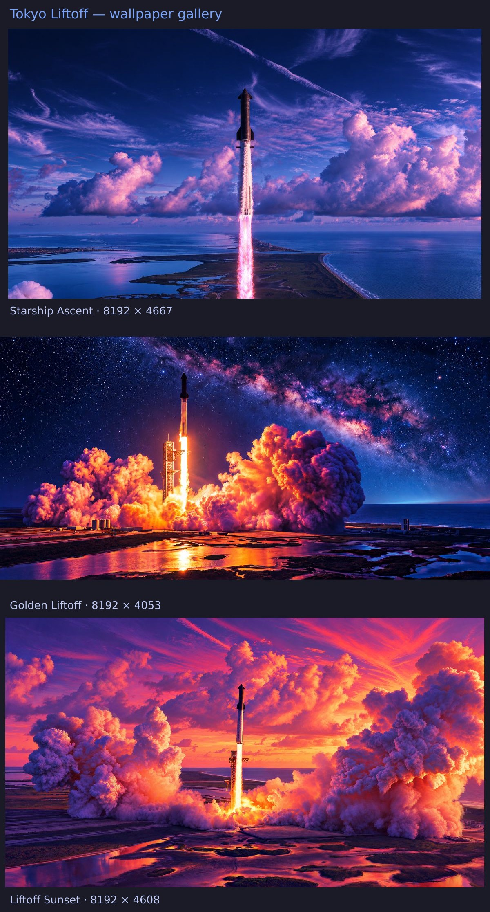

<h1 align="center">Tokyo Liftoff</h1>

<p align="center"><a href="https://github.com/tcballard/omarchy-badges"></a></p>

Tokyo Night colours. Liftoff skies.

A standalone Omarchy theme combining the complete upstream Tokyo Night palette with three approved Liftoff wallpapers: navy and lavender Starship Ascent, golden night launch, and violet sunset launch.



This gallery shows the included artwork; it is not a desktop screenshot.

Original palette: [Omarchy Tokyo Night](https://github.com/omacom/omarchy/tree/quattro/themes/tokyo-night). Artwork collection: [Liftoff](https://github.com/tcballard/omarchy-theme-liftoff).

## Install

Requires Omarchy with colors.toml theme support. Install and apply with one native command:

```bash
omarchy theme install https://github.com/tcballard/omarchy-theme-tokyo-liftoff
```

This applies the theme immediately and replaces any existing Git installation with the same directory name. Preserve local edits before reinstalling. Omarchy derives the installed directory `theme-tokyo-liftoff` from this repository name.

Choose another included wallpaper through the background picker. To pull later changes, run `omarchy theme update`, then reselect the theme:

```bash
omarchy theme set theme-tokyo-liftoff
```

## Palette

The complete `colors.toml` is copied unchanged from [Omarchy Tokyo Night](https://github.com/omacom/omarchy/blob/077ac1da939de00d061c1035e1a1d00587a119b8/themes/tokyo-night/colors.toml). Omarchy's own templates generate shell, terminal and app colours from it. Local template overrides and application support can affect the result.

| Role | Colour |
| --- | --- |
| Background | `#1a1b26` |
| Foreground | `#a9b1d6` |
| Accent | `#7aa2f7` |
| Magenta | `#ad8ee6` |
| Cyan | `#449dab` |
| Selection | `#292e42` |

## Wallpapers

| File | Artwork | Export size |
| --- | --- | --- |
| `01-starship-ascent.png` | Starship Ascent | 8192 × 4667 |
| `02-golden-liftoff.png` | Golden Liftoff | 8192 × 4053 |
| `03-liftoff-sunset.png` | Liftoff Sunset | 8192 × 4608 |

Lossless PNG recompression preserves every decoded pixel and embedded colour profile from the approved masters. Original proportions are preserved. 8K describes the assembled export; AI-reconstructed detail is not recovered photographic information.

See [credits](CREDITS.md), [media manifest](docs/wallpapers.json) and [validation](docs/validation.md).

Configuration and documentation are MIT licensed. Wallpaper rights are described separately in CREDITS.md.


## Development

Run `./tests/run`. See [architecture](ARCHITECTURE.md), [development](docs/DEVELOPMENT.md) and [acceptance evidence](docs/ACCEPTANCE.json). Built from the [Omarchy theme starter](https://github.com/tcballard/omarchy-theme-template); its retained blueprint records scaffold provenance.
